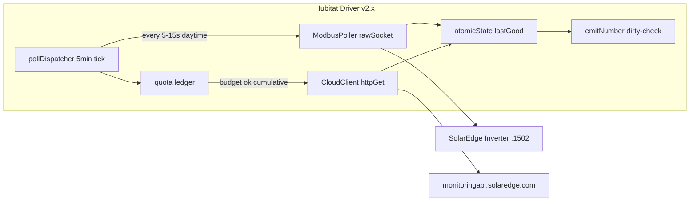

# SolarEdge Hubitat Driver — Forensic Audit Report

**Driver:** `solaredge-driver.groovy`  
**Audit baseline:** v1.2.0 (pre-refactor)  
**Remediation target:** v2.0.0  
**Date:** 2026-08-04

---

## Executive summary

The v1.2.0 driver was a **cloud-only** integration with no Modbus transport, no client-side quota accounting, and no safe-navigation on API responses. At default user settings (1-minute polling on three endpoints), it could generate **4,320 API calls per day** — **14.4×** SolarEdge's 300/day limit. Network errors could crash handlers via `MissingMethodException` inside `catch` blocks, and null API values were coerced to zero, making comms gaps indistinguishable from zero generation.

v2.0.0 addresses all Critical and High findings via a quota ledger, unified dispatcher, sandbox-safe error triage, last-good retention, corrected battery/power types, and connection-based flow direction.

---

## Critical priorities matrix

### Critical — API lockout / data reset

| ID | Finding | v1.2.0 impact | v2.0.0 fix |
|----|---------|---------------|------------|
| C1 | Three independent schedules with 1–59 min options; 13 intervals exceed 300/day when multiplied by 3 endpoints | Daily API lockout (429), possible extended blocking | Single dispatcher + `atomicState` quota ledger; default budget 150; intensity presets |
| C2 | No 429 backoff; schedule continues at same cadence | Hammering API after lockout | Exponential backoff; daily-quota 429 halts until site midnight |
| C3 | `catch` then `e.getStatusCode()` on non-HTTP exceptions | `MissingMethodException` crashes handler; tiles not updated | Nested try/catch in `onFailure()` |
| C4 | `meter.values[0].value = 0.0` on null | Comms gap shows as zero production | Preserve last-good; skip null values |

### High — battery misread / crash

| ID | Finding | v1.2.0 impact | v2.0.0 fix |
|----|---------|---------------|------------|
| H1 | `battery` attribute type `number` fed `"51.0%"` string | Battery capability broken; RM numeric rules fail | Numeric SoC |
| H2 | Charge/discharge direction never read from `connections` | Cannot tell if battery is charging or discharging | `storage_direction` from connections |
| H3 | Flow math `PV + storage - LOAD` uses unsigned storage magnitude | Grid indicator wrong when battery charging | Connection-based `flow_direction` |
| H4 | 15 unguarded `values[0]` dereferences; no `?.` | NPE on empty arrays or missing PV | Safe navigation throughout |
| H5 | Power stored as display strings; unit from API not normalized | 1000× error if API returns kW vs W | `toWatts()` normalization |

### Medium — efficiency / correctness

| ID | Finding | v2.0.0 fix |
|----|---------|------------|
| M1 | `YYYY` week-year in date format | `yyyy-MM-dd` with site timezone |
| M2 | Hub TZ vs site TZ for day boundary | `site_timezone` preference |
| M3 | `delayBetween([sendEvent(...)])` no-op | Removed; dirty-checked emits |
| M4 | No `httpGet` timeout | 30s timeout on all requests |
| M5 | Three crons at `:00` | Single cron at `:10` past each 5-min mark |
| M6 | No dirty-checking on 36 sendEvents | `emitNumber` / `emitCumulative` deadband |
| M7 | Enum `255` compared to string `"255"` | Replaced by intensity presets |

### Low — cosmetic / distribution

| ID | Finding | v2.0.0 fix |
|----|---------|------------|
| L1 | Missing `</span>` on Import tile row | Fixed in compact tile renderer |
| L2 | Manifest v1.1.2 vs driver v1.2.0 | Synced to 2.0.0 |
| L3 | No SolarEdge attribution on tiles | Link to solaredge.com per API terms |
| L4 | Dead `production_status` variable | Removed |

---

## Concrete code deltas (top 3 fatal flaws)

### 1. Rate-limit / quota defense

**Before (v1.2.0):**
```groovy
if (settings.energy_refresh_interval != "255")
    schedule("0 */${settings.energy_refresh_interval} * ? * * *", queryEnergyEndpoint)
// No call counting; 429 only logged
case 429:
    log.error "429 - Too many requests"
    break
```

**After (v2.0.0):**
```groovy
private boolean spendCall(String tag) {
    resetQuotaIfNewDay()
    int budget = Math.min(280, (settings.daily_budget ?: 150) as int)
    int used = (atomicState.quotaUsed ?: 0) as int
    if (used >= budget) { setApiStatus("quota_guard"); return false }
    if (now() < ((atomicState.backoffUntil ?: 0L) as long)) return false
    atomicState.quotaUsed = used + 1
    return true
}
schedule("10 */5 * ? * *", "pollDispatcher")
```

### 2. Safe JSON navigation (replaces NPE-prone dereference)

**Before:**
```groovy
if (meter.values[0].value == null) meter.values[0].value = 0.0
sendEvent(name: "production", value: meter.values[0].value)
```

**After:**
```groovy
def value = meter?.values?.getAt(0)?.value
if (value == null) {
    if (dbg()) log.debug "${meter?.type}: no data yet — preserving last-good"
    return
}
emitCumulative("production", value, "Wh")
```

### 3. Battery direction and signed power (Modbus-relevant pattern; applied to cloud API)

**Before:**
```groovy
sendEvent(name: "storage_power", value: r.data.siteCurrentPowerFlow.STORAGE.currentPower + " " + unit)
sendEvent(name: "battery", value: r.data.siteCurrentPowerFlow.STORAGE.chargeLevel + "%")
storagePower = r.data.siteCurrentPowerFlow.STORAGE.currentPower
if (PV.currentPower + storagePower - LOAD.currentPower > 0) state.flow_direction = "green"
```

**After:**
```groovy
boolean storageCharging = conns.any { it?.to?.toString()?.equalsIgnoreCase("STORAGE") }
BigDecimal mag = toWatts(flow.STORAGE?.currentPower, unit)
emitNumber("storage_power", storageCharging ? -mag : mag, 5, "W")
emitNumber("battery", flow.STORAGE?.chargeLevel, 1, "%")
state.flow_direction = gridExport ? "green" : (gridImport ? "red" : "gray")
```

---

## Configurational intelligence (v2.0.0)

| Preference | Purpose |
|------------|---------|
| **Polling Intensity** | Low (~48) / Medium (~90) / High (~200) / Custom |
| **Daily API call budget** | Hard ceiling independent of intensity (default 150, max 280) |
| **Night mode** | Suspend real-time endpoints overnight; one post-sunset energy close-out |
| **Site timezone** | Correct site-local midnight for quota reset and energy day window |
| **Custom intervals** | Per-endpoint minutes when Intensity = Custom |

Solar phase uses `location.sunrise` / `location.sunset` to tighten daytime cadence without wasting quota overnight.

---

## Final blueprint — ultra-lean dual-transport driver (phase 2)

Phase 1 (v2.0.0) hardens the cloud path. Phase 2 adds local Modbus TCP for sub-second power while reserving cloud for cumulative kWh backfill.



### Class decomposition (pseudo-code)

```
SolarEdgeDriver
├── pollDispatcher()           // cron tick, free
├── spendCall(tag)             // atomicState quota
├── ModbusTransport
│   ├── connect(host, 1502)
│   ├── readHoldingRegisters(addr, count)
│   ├── decodeSunSpecInt16(regs, scaleFactorReg)  // 40083 + 40084
│   ├── decodeBatteryFloat32(regs)               // 0xE100, LSW-first
│   └── guardSentinel(value)                     // 0x8000, 0xFFFF, -32768
├── CloudTransport
│   ├── getEnergyDetails()
│   ├── getOverview()
│   └── getCurrentPowerFlow()
├── Parsers
│   ├── parseMeters(json)
│   └── parsePowerFlow(json, connections)
└── Emitters
    ├── emitNumber(name, w, deadband=5)
    └── emitCumulative(name, wh)
```

### Modbus register notes (phase 2)

| Block | Address | Encoding | Pitfall |
|-------|---------|----------|---------|
| SunSpec AC power | 40083 (int16) + 40084 (SF) | `value × 10^SF` | SF `0xFFFF` = -1; sign-extend |
| Battery power | 0xE174 (62836) | float32 | **Little-endian word order** (LSW first) |
| Battery SoC | 0xE184 (62852) | float32 | Same word order |
| Not implemented | — | — | `0x8000`, `0xFFFF` → skip, don't emit |

Hubitat has no native Modbus library; use `interfaces.rawSocket` with manual MBAP/PDU frame assembly, 5s read timeout, and reconnect on `SocketException`. Target **<30ms** per poll by reading a contiguous register block (e.g. 40083–40090) in one FC3 request.

### Cloud budget target

With Modbus handling instantaneous W, cloud calls drop to:
- `energyDetails`: 4×/day (every 6h) = 4
- `overview`: 2×/day = 2
- `currentPowerFlow`: 0 (Modbus replaces) = 0  
**Total: <10 calls/day** — well under 100/day target.

---

## Verification checklist

- [ ] `apiCallsToday` stays under `daily_budget` over 24h at Medium intensity
- [ ] Disconnect network → `apiStatus=degraded`, values held, no stack trace
- [ ] Invalid API key → `auth_failed`, polling halted until re-save
- [ ] Tile attributes remain under 1024 characters
- [ ] Battery shows numeric SoC; `storage_power` negative when charging
- [ ] `lifetime` never decreases on partial API response

---

## References

- [SolarEdge Monitoring API PDF](https://knowledge-center.solaredge.com/sites/kc/files/se_monitoring_api.pdf)
- [SolarEdge Modbus Technical Note (TerraMax)](https://knowledge-center.solaredge.com/sites/kc/files/se-modbus-interface-for-solaredge-terramax-inverter-technical-note.pdf)
- Hubitat attribute 1024-character limit (community documented)
